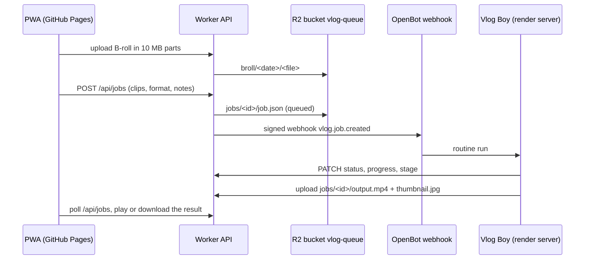

# Vlog Queue

An Expo (web) PWA for sending B-roll to the Vlog Boy agent and collecting the finished videos.

- **Live app:** https://thl007.github.io/vlog-queue/ (add it to your home screen to install it)
- **API:** https://vlog-queue-api.thl007.workers.dev (Cloudflare Worker, bound to the R2 bucket `vlog-queue`)

## How it works



## Library

Uploads land in `broll/_inbox/`. When a batch finishes, the app sends `vlog.broll.uploaded` and Vlog Boy sorts the clips into folders (`worker/organize.mjs inspect` makes contact sheets, `move` applies the plan). Every clip has a thumbnail at `thumbs/<clip key>.jpg`: the browser grabs one at upload, and Vlog Boy fills in any that are missing. The library shows folders collapsed and loads a folder's contents only when you open it.

Title and length are optional: when they are empty, Vlog Boy picks them (`run-job.mjs --title`, `--max`).

The bucket is the source of truth. The browser never sees bucket keys or the webhook secret: it only holds an access token, and reads files through signed links that expire after an hour.

## Video types

Shown first: Vlog Boy picks, Blank, Montage, Day in the life, Travel, Food, Get ready with me, How-to, Cinematic, Talking head. Behind "More types" (collapsed): 22 more, from Illustrated explainer and Event recap to Music video and Interview. **Blank** is a plain cut (clips in order, no styling). **Custom** takes your own description; Vlog Boy turns it into pacing (`run-job.mjs --pace`) and styling. The type sets the cut pacing in `run-job.mjs` and tells Vlog Boy how to dress the edit. The list lives in `src/lib/api.ts`; the API and render script mirror it.

## Queue layouts

Overview (rendering, up next, needs a look, done), Board (a column per status), Table (every job), Gallery (finished videos only). Layout and type filter live in the URL (`?view=queue&layout=board&type=food`).

## Design

Hallmark, Halftone theme (app-screen scope), Google Fonts only: Ultra for headings, Chivo for the UI.

## Formats

| Preset | Size | For |
| --- | --- | --- |
| `short-9x16` | 1080 × 1920 | Shorts, Reels, TikTok (60 s default cap) |
| `vlog-16x9` | 1920 × 1080 | YouTube |
| `square-1x1` | 1080 × 1080 | Feed posts |
| `portrait-4x5` | 1080 × 1350 | Instagram feed |

Upload an audio file with the clips and pick it: it becomes the music bed, ducked under the clip sound. Everything is loudness-normalised to -14 LUFS.

## Layout

- `src/app/` — Expo Router screen (`?view=queue|new|settings`)
- `src/components/` — queue, new video, settings
- `src/styles/` — Hallmark Midnight tokens (`tokens.css`, `base.css`) and `app.css`
- `public/` — `index.html`, `manifest.json`, `sw.js`, icons
- `worker/src/index.js` — Cloudflare Worker API
- `worker/run-job.mjs` — the ffmpeg render that the Vlog Boy routine runs

## Develop

```bash
npm install
npm run web        # dev server
npm run build      # static export to dist/
```

`npm run deploy` builds and publishes `dist/` to the `gh-pages` branch, which GitHub Pages serves.

## Worker secrets

`APP_TOKEN` (the access token you type into Settings) and `WEBHOOK_SECRET` (the OpenBot routine's signing secret). `WEBHOOK_URL` is in `worker/wrangler.toml`.
